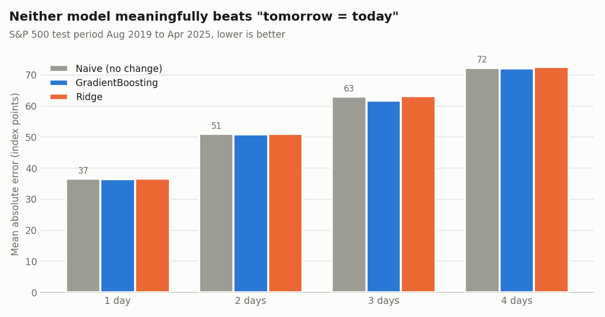

# S&P 500 Short-Horizon Forecasting

[](https://github.com/ashutosh0804k/spx-forecast/actions/workflows/tests.yml)

Can a machine learning model predict the S&P 500 close 1 to 4 trading days ahead better than just assuming the price won't move?

I built a leakage-safe pipeline to answer that honestly: engineered features from four global indices, trained Gradient Boosting and Ridge models on 22 years of data, and backtested them against a naive "tomorrow = today" baseline on the most recent 5.5 years. **Neither model beats the baseline by a statistically meaningful margin at any horizon.** That is the expected result for a liquid, efficient market, and the point of this project is showing how to measure it correctly instead of reporting a misleading score.



## Results

Test period Aug 2019 to Apr 2025 (1,298 trading days), trained on Mar 1997 to Aug 2019. MAE is in S&P 500 index points, lower is better. The percentage is versus the naive baseline, and the p-value is a paired t-test on absolute errors against that baseline.

| Horizon | Naive MAE | Gradient Boosting | Ridge | Up-days share | GB direction accuracy |
|---|---|---|---|---|---|
| 1 day | 36.7 | 36.5 (-0.5%, p=0.52) | 36.7 (+0.1%, p=0.92) | 54.4% | 52.8% |
| 2 days | 51.0 | 50.9 (-0.2%, p=0.69) | 51.1 (+0.1%, p=0.98) | 59.1% | 54.5% |
| 3 days | 63.0 | 61.6 (-2.2%, p=0.25) | 63.1 (+0.1%, p=0.69) | 58.6% | 53.5% |
| 4 days | 72.3 | 72.0 (-0.4%, p=0.72) | 72.6 (+0.3%, p=0.94) | 60.9% | 53.9% |

How to read this:

- Gradient Boosting shaves 0.2% to 2.2% off the baseline error, but every p-value is well above 0.05, so the gain is indistinguishable from noise.
- Direction accuracy looks decent (53% to 55%) until you compare it with the share of days the market simply went up (54% to 61%). A model that always predicts "up" would do better.
- **Adding VIX made things worse.** VIX data only starts in 2020, so the VIX variant trains on 4 years instead of 22. It lost to the baseline at every horizon, and at 1 day it was significantly worse (+7.0%, p=0.03), a clear overfitting signal. Full numbers are in [`results/backtest_vix.csv`](results/backtest_vix.csv).

## Why the high R² scores you see online are misleading

Stock price models often report R² above 0.99. That number mostly measures that today's price is close to yesterday's, which is true for any model that is fed yesterday's price. It gets worse when rows are split randomly with `train_test_split` (the default `shuffle=True`): the model trains on days on both sides of every test day, so it is effectively interpolating, not forecasting.

This pipeline avoids both traps:

- **Predict returns, not prices.** Models predict the log return over the next h days, and the price is rebuilt afterwards. The price level itself is never a feature.
- **Chronological split, never shuffled.** The oldest 80% trains, the newest 20% tests.
- **Purge gap.** An h-day target on the last training rows would reach into the test period, so h rows are dropped between the two sets.
- **Compare against a baseline.** Error is always reported next to the naive "no change" forecast, with a significance test.

## How it works

**Data** (`data/`): daily closes for the S&P 500, DAX, FTSE 100 and Nikkei 225 from 1997 to April 2025, plus VIX from FRED for 2020 to 2025. Foreign markets have different holidays, so their last close is carried forward (never backward).

**Features** (`spx_forecast/features.py`), all known at the close of day t:
- Log returns for each of the four indices over the last 5 days
- S&P 500 realized volatility over 10 and 30 days
- S&P 500 distance from its 20 and 50 day moving averages
- Optional: VIX level and daily change

**Targets**: `log(close[t+h] / close[t])` for h = 1, 2, 3, 4. Each horizon gets its own model (direct forecasting), so predicted prices are never fed back in as inputs and errors don't compound.

**Models** (`spx_forecast/models.py`): Gradient Boosting (250 shallow trees, depth 3, subsampled) and Ridge regression on standardized features, both from scikit-learn.

## Tests

The test suite checks the pipeline for the mistakes that usually inflate forecasting results:

- **No look-ahead:** crash every price after day t by 50% and assert that every feature up to day t is unchanged.
- **Target alignment:** each target equals the true log return h days ahead.
- **Split safety:** training dates end before test dates, the purge gap is at least h rows, and no training target reaches into the test period.
- **Holiday handling:** missing foreign closes are filled forward, never from the future.
- **End to end:** the real dataset has no gaps, and forecasts land on business days after the last close.

I verified the tests catch real bugs by injecting two: a centered moving average (a subtle look-ahead leak) and a split with no purge gap. Both failed the suite as intended. CI runs the tests and the full backtest on Python 3.10 to 3.12 on every push.

## Run it

```bash
pip install -r requirements.txt

pytest                                  # run the test suite
python -m spx_forecast.evaluate         # backtest, writes results/backtest.csv
python -m spx_forecast.evaluate --vix   # VIX variant, writes results/backtest_vix.csv
python -m spx_forecast.plot             # redraw results/mae_by_horizon.png
python -m spx_forecast.forecast         # forecast the next 4 trading days
```

The forecast uses the latest close in `data/indices.csv`. Business days are counted without an exchange holiday calendar, so check dates around market holidays.

## Project structure

```
spx_forecast/
  data.py        load and align the index and VIX data
  features.py    features and multi-horizon targets
  models.py      models and the purged chronological split
  evaluate.py    backtest against the naive baseline
  forecast.py    next 1-4 day forecast
  plot.py        results chart
tests/           leakage, split, and end-to-end tests
data/            input CSVs
results/         backtest output and chart
```

## Background

This started as my individual model in a three-person team project for a machine learning course at Syracuse University (Spring 2025), where each team member built a separate approach to predict the S&P 500 close 1 to 4 days ahead. My original version was a Gradient Boosting model on next-day returns with a time-ordered split. Rebuilding it for this repo, I found and fixed a data bug (one input file ended in January 2025 and an inner join silently dropped every later row), switched to direct multi-horizon forecasting, and added the baseline comparison, significance tests, and test suite.

## Data sources

- S&P 500, DAX, FTSE 100, Nikkei 225 daily closes: Yahoo Finance
- VIX: Federal Reserve Bank of St. Louis, FRED series [VIXCLS](https://fred.stlouisfed.org/series/VIXCLS)

This is a learning project, not investment advice.
